# Jarkom-Modul-3-2026-K-39

| Nama | NRP |
|---|---|
| Asfia Fahmisan | 5027251043 |
| Muhammad Atallah Mas'udi | 5027251071 |

---

## Topologi Jaringan

Pada praktikum Modul 3 ini (Curtain Protocol: Shibuya Incident), seluruh zona komunikasi Jujutsu High dihubungkan melalui sebuah router utama bernama jichi dan server DHCP utama bernama tengen:

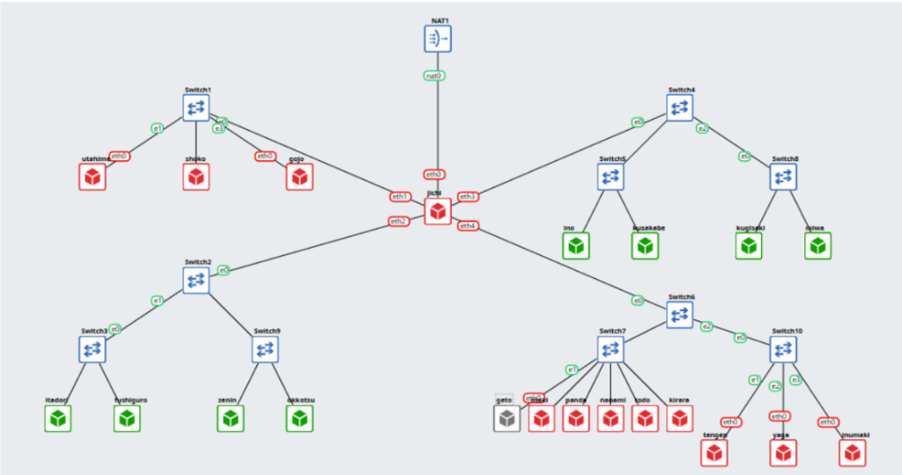

### Parameter Global:
* Prefix IP Kelompok K-39: 10.83
* Subnet Mask: /24 (255.255.255.0)
* Upstream Internet (NAT): Interface eth0 pada jichi memperoleh IP secara dinamis dari NAT (192.168.122.0/24) dengan default gateway 192.168.122.1.
* Image Docker:
  * Router & Server: ardhptr21/debinet:latest
  * Client: ardhptr21/alpinet:latest

### Tabel Alokasi IP Address Host:
| Node | Interface | IP Address | Netmask | Gateway | Peran / Keterangan |
| :--- | :--- | :--- | :--- | :--- | :--- |
| jichi | eth0 eth1 eth2 eth3 eth4 | DHCP (NAT) 10.83.1.1 10.83.2.1 10.83.3.1 10.83.4.1 | /24 /24 /24 /24 /24 | 192.168.122.1 - - - - | Router Utama & DHCP Relay Gateway DMZ (Net 1) Gateway Divisi A (Net 2) Gateway Divisi B (Net 3) Gateway Data Center (Net 4) |
| utahime | eth0 | 10.83.1.2 | /24 | 10.83.1.1 | DNS Master (Network 1 - DMZ) |
| shoko | eth0 | 10.83.1.3 | /24 | 10.83.1.1 | DNS Slave (Network 1 - DMZ) |
| gojo | eth0 | 10.83.1.4 | /24 | 10.83.1.1 | Public Reverse Proxy (Network 1 - DMZ) |
| itadori | eth0 | DHCP (10.83.2.10 sampai .35) | /24 | 10.83.2.1 | Klien Divisi A (Pool 1 - Tim Dev) |
| fushiguro | eth0 | DHCP (10.83.2.10 sampai .35) | /24 | 10.83.2.1 | Klien Divisi A (Pool 1 - Tim Dev) |
| zenin | eth0 | DHCP (10.83.2.70 sampai .95) | /24 | 10.83.2.1 | Klien Divisi A (Pool 2 - Tim Support) |
| okkotsu | eth0 | DHCP (10.83.2.70 sampai .95) | /24 | 10.83.2.1 | Klien Divisi A (Pool 2 - Tim Support) |
| ino | eth0 | DHCP (10.83.3.10 sampai .89) | /24 | 10.83.3.1 | Klien Divisi B (Short Lease 1800s) |
| kusakabe | eth0 | DHCP (10.83.3.10 sampai .89) | /24 | 10.83.3.1 | Klien Divisi B (Short Lease 1800s) |
| miwa | eth0 | DHCP (10.83.3.100 sampai .199)| /24 | 10.83.3.1 | Klien Divisi B (Long Lease 43200s) |
| kugisaki | eth0 | 10.83.3.99 (Fixed) | /24 | 10.83.3.1 | Klien Divisi B (Static Reservation) |
| tengen | eth0 | 10.83.4.10 | /24 | 10.83.4.1 | DHCP Server (Network 4 - Data Center) |
| geto | eth0 | 10.83.4.2 | /24 | 10.83.4.1 | Internal Load Balancer |
| maki | eth0 | 10.83.4.3 | /24 | 10.83.4.1 | Web Worker Frontend 1 |
| panda | eth0 | 10.83.4.4 | /24 | 10.83.4.1 | Web Worker Frontend 2 |
| nanami | eth0 | 10.83.4.5 | /24 | 10.83.4.1 | API Worker Utama 1 |
| todo | eth0 | 10.83.4.6 | /24 | 10.83.4.1 | API Worker Utama 2 |
| kirara | eth0 | 10.83.4.7 | /24 | 10.83.4.1 | API Worker Cadangan |
| yaga | eth0 | 10.83.4.8 | /24 | 10.83.4.1 | DB Master MariaDB |
| inumaki | eth0 | 10.83.4.9 | /24 | 10.83.4.1 | DB Slave MariaDB |

---

## Soal 1

Ketika Curtain menutup Shibuya, jalur komunikasi antar zona Jujutsu High terputus. Pulihkan konektivitas dasar dengan mengonfigurasi jichi: eth0 memperoleh WAN dari NAT, sedangkan eth1 sampai eth4 menjadi gateway Network 1 sampai 4 sesuai tabel pemetaan. Aktifkan IPv4 forwarding dan source NAT, lalu tetapkan IP statis host infrastruktur sesuai tabel spesifikasi. Buktikan konektivitas setiap host ke gateway dan akses eksternal dari host yang relevan.

### Konfigurasi dan Penjelasan:
Kami mengonfigurasi router jichi sebagai pusat perutean antar zona. Interface eth0 dikonfigurasi untuk menerima IP dinamis dari jaringan NAT, sedangkan eth1 sampai eth4 ditetapkan sebagai gateway masing-masing subnet: DMZ pada 10.83.1.1, Divisi A pada 10.83.2.1, Divisi B pada 10.83.3.1, dan Data Center pada 10.83.4.1. Kami mengaktifkan fitur net.ipv4.ip_forward agar kernel Linux meneruskan paket antar antarmuka, serta memasang aturan iptables MASQUERADE pada eth0 agar host jaringan lokal dapat mengakses jaringan internet luar.

Seluruh server infrastruktur pada DMZ dan Data Center kami pasang IP statis dengan subnet mask 255.255.255.0 dan default gateway yang mengarah ke interface jichi pada segmen masing-masing.

### Bukti Verifikasi:
Pemeriksaan antarmuka, aturan NAT, dan pengujian ping internet pada jichi:

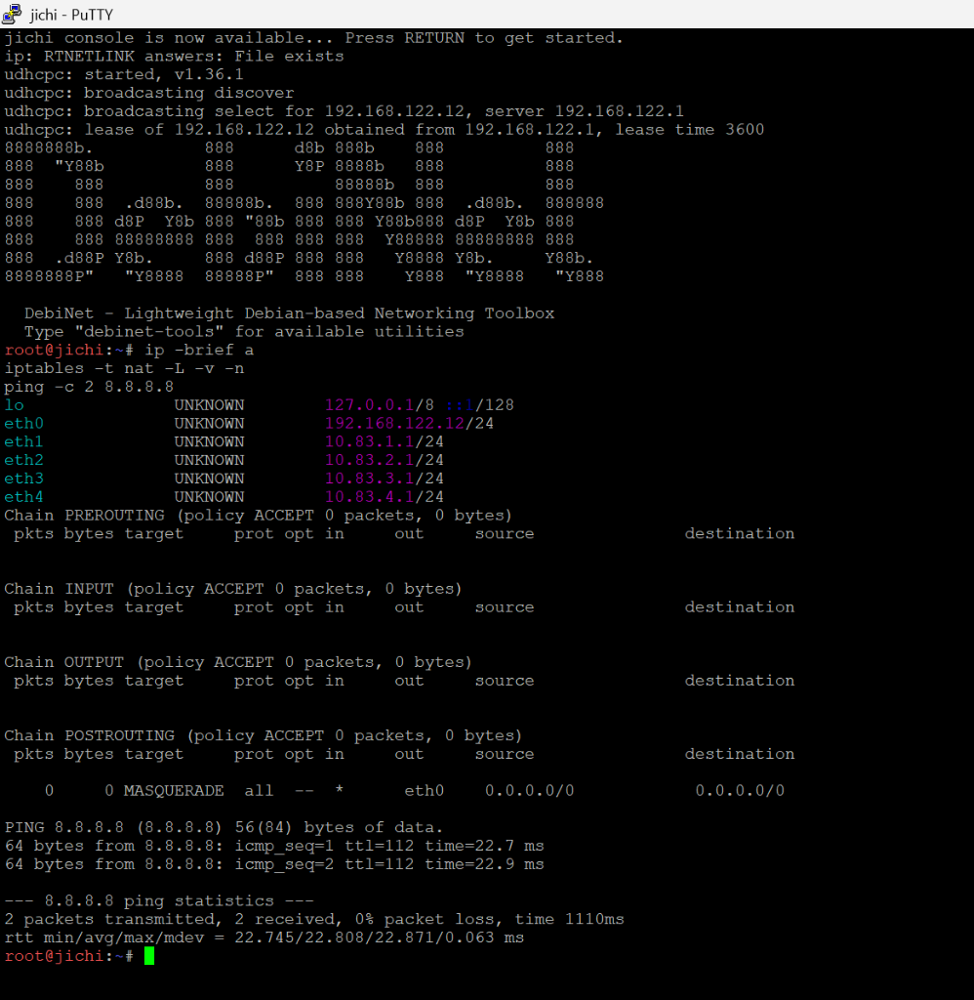

Pemeriksaan IP statis dan tes konektivitas dari server tengen menuju gateway 10.83.4.1 serta internet:

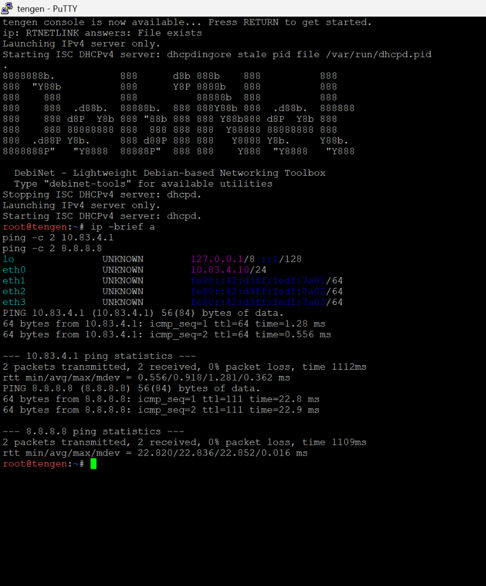

---

## Soal 2

Tengen, penjaga pusat distribusi di Data Center, harus mengambil alih pengalokasian alamat bagi wilayah yang membutuhkan konfigurasi dinamis. Konfigurasikan isc-dhcp-server pada 10.83.4.10. Deklarasikan Network 4 (10.83.4.0/24) sebagai subnet lokal tanpa pool dinamis, lalu siapkan scope DHCP untuk Network 2 (10.83.2.0/24) dan Network 3 (10.83.3.0/24). Validasi konfigurasi dan pastikan service aktif tanpa error "No subnet declaration".

### Konfigurasi dan Penjelasan:
Kami memasang paket isc-dhcp-server pada node tengen (10.83.4.10) dan menetapkan interface eth0 sebagai antarmuka layanan.

Pada file /etc/dhcp/dhcpd.conf, kami mendeklarasikan subnet 10.83.4.0/24 tanpa baris range alokasi. Deklarasi kosong ini diperlukan karena daemon DHCP mewajibkan deklarasi subnet lokal pada antarmuka yang didengarkannya. Tanpa deklarasi tersebut, daemon akan berhenti dengan galat "No subnet declaration for eth0". Scope subnet untuk Network 2 dan Network 3 juga kami siapkan agar server siap melayani permintaan sewa dari divisi lain.

### Bukti Verifikasi:
Hasil pengujian status layanan dan pengecekan socket UDP port 67 pada tengen:

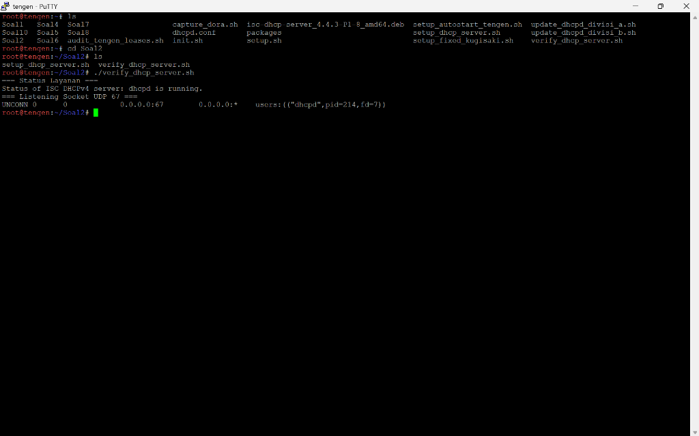

---

## Soal 3

Permintaan alamat dari Divisi A dan Divisi B tidak dapat menyeberangi subnet secara langsung. Konfigurasikan jichi sebagai DHCP Relay menuju tengen (10.83.4.10), menggunakan eth2 untuk Network 2 dan eth3 untuk Network 3. Buktikan bahwa client dari kedua subnet berhasil memperoleh lease melalui relay.

### Konfigurasi dan Penjelasan:
Karena router secara default tidak meneruskan paket siaran (broadcast) lintas subnet, kami mengonfigurasi isc-dhcp-relay pada router jichi. Relay diarahkan ke server tengen (10.83.4.10) dengan mendengarkan interface eth1, eth2, eth3, dan eth4.

Saat klien di Divisi A atau Divisi B mengirimkan siaran DHCP Discover, jichi menangkap paket tersebut, mengisi alamat gateway interface penerima pada field giaddr (10.83.2.1 atau 10.83.3.1), lalu meneruskannya secara unicast ke tengen.

### Bukti Verifikasi:
Status proses dan verifikasi port UDP 67 untuk layanan relay pada jichi:

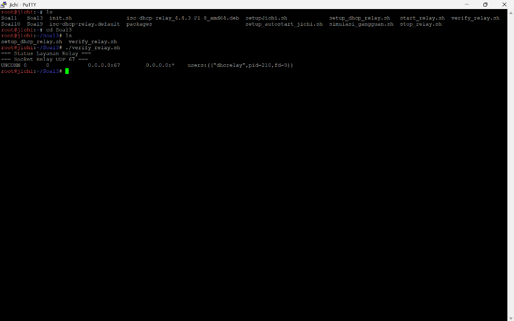

---

## Soal 4

Agar tim Dev dan Support di Divisi A menerima jatah alamat yang berbeda, atur dua pool DHCP pada Network 2. Tetapkan Pool 1 (10.83.2.10 sampai 10.83.2.35) untuk itadori dan fushiguro, serta Pool 2 (10.83.2.70 sampai 10.83.2.95) untuk zenin dan okkotsu. Rentang 10.83.2.36 sampai 10.83.2.69 tidak boleh dialokasikan. Karena seluruh client berada pada subnet yang sama, gunakan DHCP class berdasarkan MAC Address atau Client ID untuk memisahkan kedua kelompok.

### Konfigurasi dan Penjelasan:
Untuk membagi klien di subnet yang sama ke dalam rentang alamat yang berbeda, kami membuat dua class pada konfigurasi DHCP: dev-pool1 dan support-pool2. Masing-masing klien didaftarkan melalui baris subclass menggunakan MAC address fisiknya.

Pool 1 dibatasi untuk anggota dev-pool1 dengan rentang 10.83.2.10 sampai 10.83.2.35. Pool 2 dibatasi untuk anggota support-pool2 dengan rentang 10.83.2.70 sampai 10.83.2.95. Rentang 10.83.2.36 sampai 10.83.2.69 sengaja tidak dideklarasikan pada pool mana pun agar tidak teralokasi dan terisolasi dengan aman.

### Bukti Verifikasi:
Bukti perolehan IP klien Tim Dev pada Pool 1:

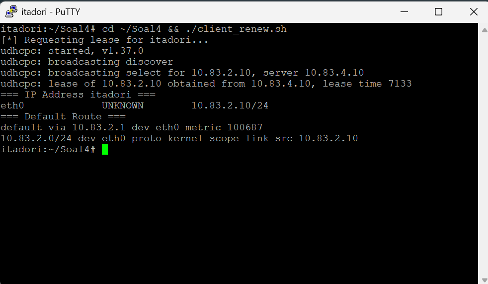

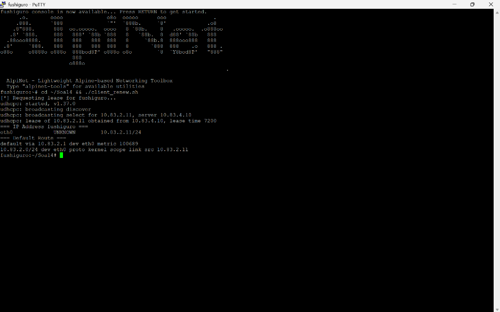

Bukti perolehan IP klien Tim Support pada Pool 2:

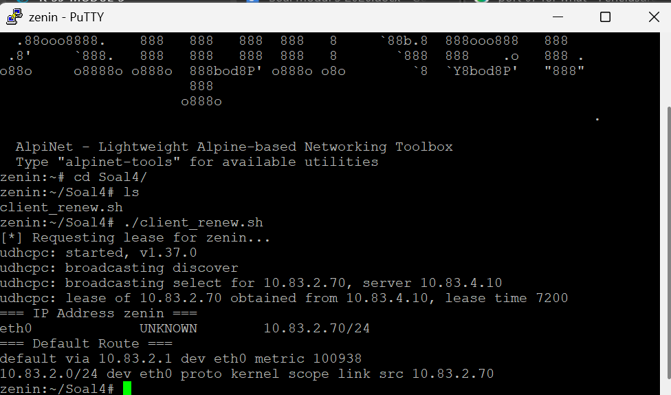

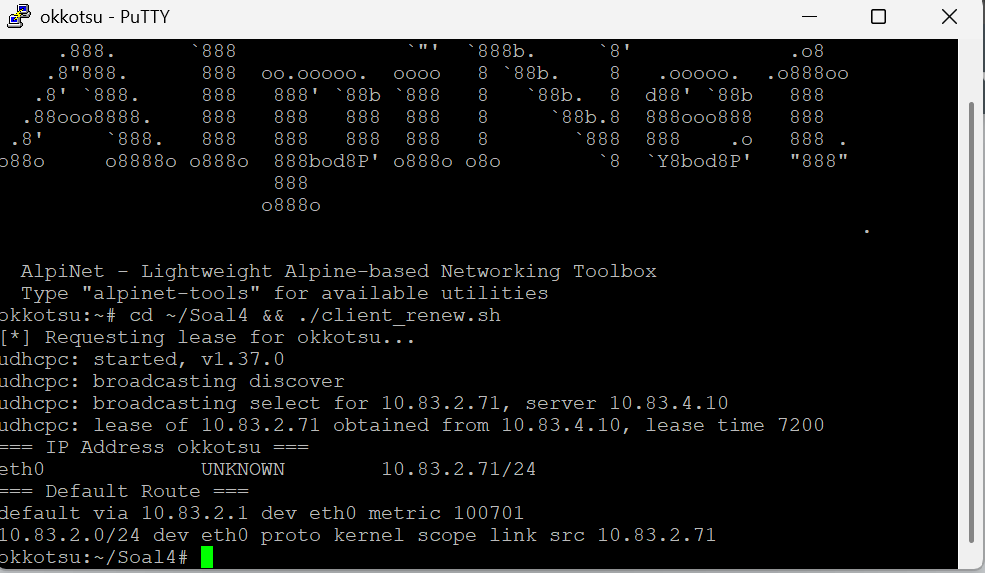

---

## Soal 5

Setiap tim lapangan memiliki durasi operasi yang berbeda. Pada Network 3, berikan short lease 30 menit (1800 detik) kepada ino dan kusakabe, serta long lease 12 jam (43200 detik) kepada miwa. Gunakan pool short lease 10.83.3.10 sampai 10.83.3.89 dan pool long lease 10.83.3.100 sampai 10.83.3.199. Sesuaikan default-lease-time dan max-lease-time untuk setiap kelas client. Berikan pula DHCP options berupa DNS 10.83.1.2 dan 10.83.1.3, serta domain-search k39.com.

### Konfigurasi dan Penjelasan:
Kami membedakan durasi masa sewa pada Network 3 menggunakan dua class: short-lease dan long-lease.

Pool short-lease dialokasikan untuk ino dan kusakabe pada rentang 10.83.3.10 sampai 10.83.3.89 dengan masa sewa 1800 detik (30 menit). Pool long-lease dialokasikan untuk miwa pada rentang 10.83.3.100 sampai 10.83.3.199 dengan masa sewa 43200 detik (12 jam).

Kami juga menambahkan opsi jaringan global pada subnet berupa router gateway 10.83.3.1, DNS resolver 10.83.1.2 dan 10.83.1.3, serta domain pencarian k39.com yang otomatis diterapkan pada file /etc/resolv.conf klien.

### Bukti Verifikasi:
Penerapan konfigurasi baru pada tengen:

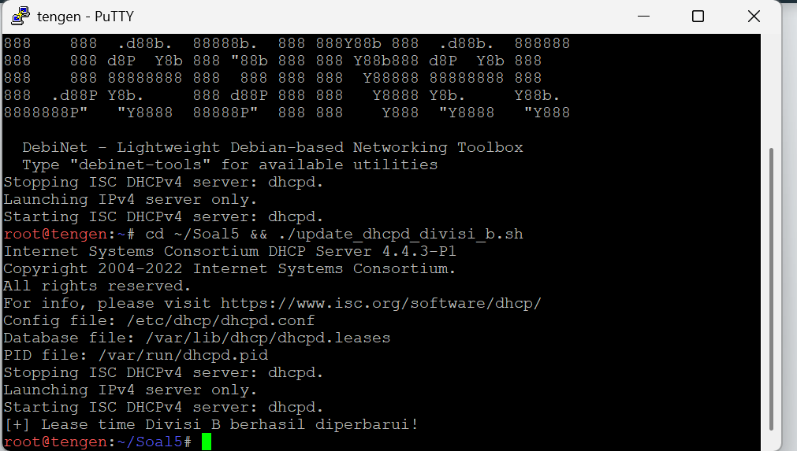

Hasil permohonan sewa ino dengan masa sewa 1800 detik:

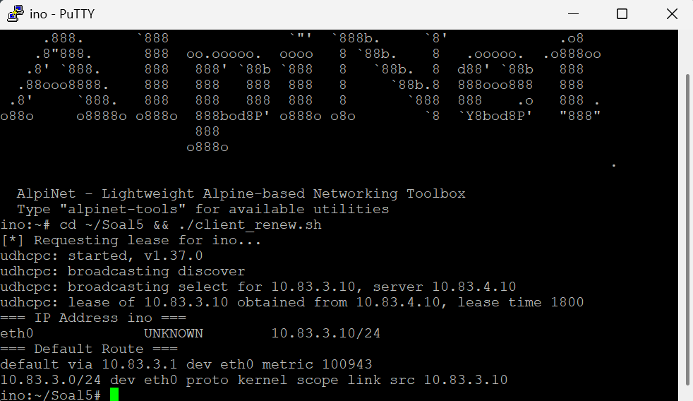

Hasil permohonan sewa kusakabe dengan masa sewa 1800 detik:

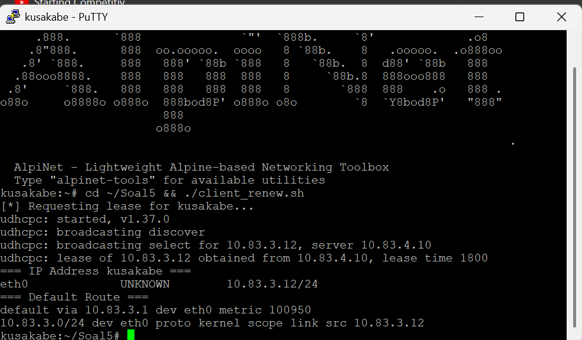

Hasil permohonan sewa miwa dengan masa sewa 43200 detik dan verifikasi file resolv.conf:

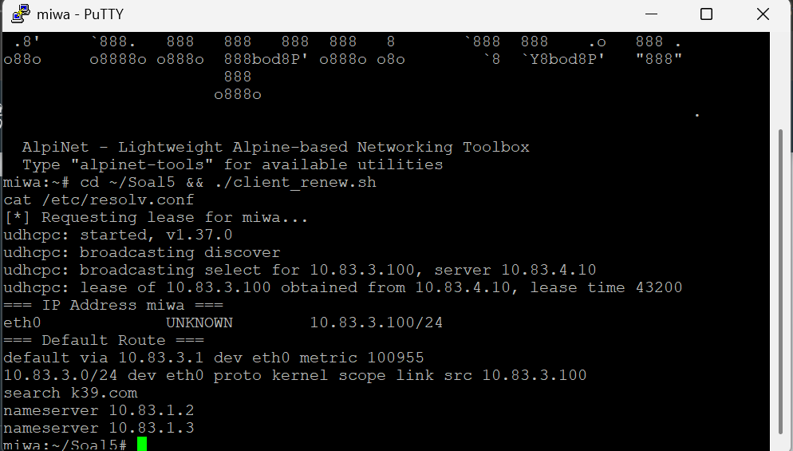

---

## Soal 6

Kugisaki ditetapkan sebagai personel VIP yang harus mempertahankan alamat yang sama setiap kali terhubung. Buat DHCP static lease berdasarkan MAC Address client tersebut dengan fixed address 10.83.3.99. Pastikan alamat ini berada di luar seluruh pool dinamis, validasi konfigurasi server, lalu renew lease pada client. Buktikan bahwa alamat yang diterima sesuai dengan reservasi.

### Konfigurasi dan Penjelasan:
Kami membuat reservasi IP statis melalui blok deklarasi host kugisaki pada konfigurasi DHCP server. MAC address ethernet milik kugisaki (02:42:c1:a8:92:00) dipetakan secara permanen ke alamat 10.83.3.99.

Alamat 10.83.3.99 berada di luar batas pool sewa dinamis Divisi B (antara batas atas pool pendek .89 dan batas bawah pool panjang .100), sehingga memenuhi syarat untuk tidak bersinggungan dengan pool dinamis klien lain.

### Bukti Verifikasi:
Hasil permohonan sewa pada kugisaki yang menerima tepat alamat 10.83.3.99 dengan gateway 10.83.3.1:

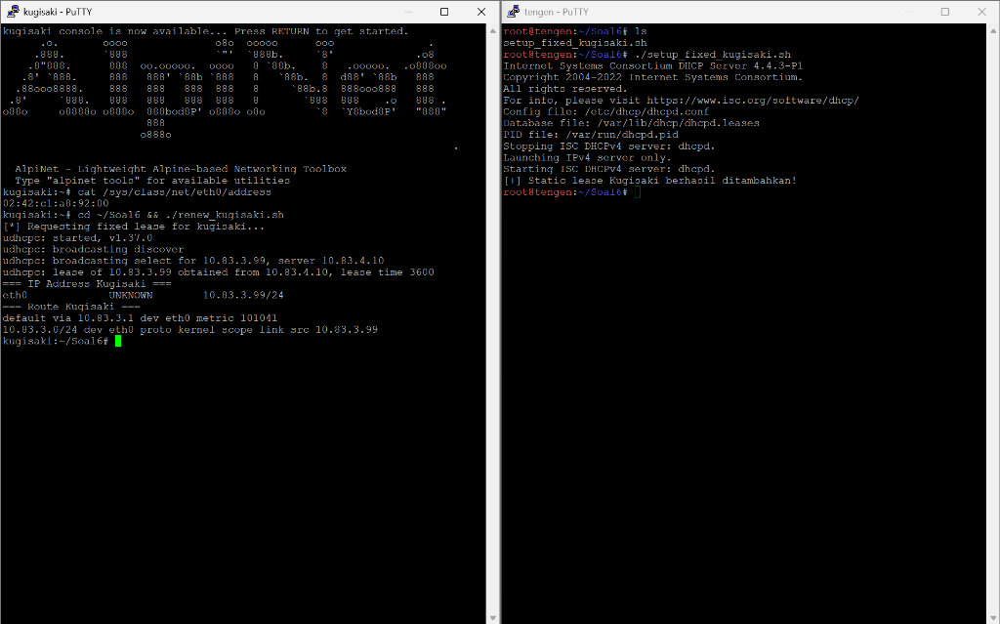

---

## Soal 7

Setelah aturan alokasi diterapkan, pastikan setiap client menerima konfigurasi jaringan sesuai wilayahnya: subnet mask 255.255.255.0 (/24), gateway dan broadcast address yang benar, DNS 10.83.1.2 serta 10.83.1.3, dan domain-search yang ditentukan. Periksa IP address dan routing seluruh client Divisi A dan Divisi B, kemudian cocokkan lease dengan /var/lib/dhcp/dhcpd.leases pada tengen. Pastikan tidak ada alamat yang bertabrakan atau berada di luar kebijakan pool.

### Konfigurasi dan Penjelasan:
Kami memeriksa catatan basis data sewa aktif pada file /var/lib/dhcp/dhcpd.leases di tengen. Setiap entri sewa diverifikasi untuk memastikan alamat IP, MAC address, serta waktu awal dan akhir sewa tercatat sesuai dengan pembagian pool yang telah ditentukan, tanpa adanya tabrakan alamat antar host.

### Bukti Verifikasi:
Tampilan audit database sewa aktif pada server tengen:

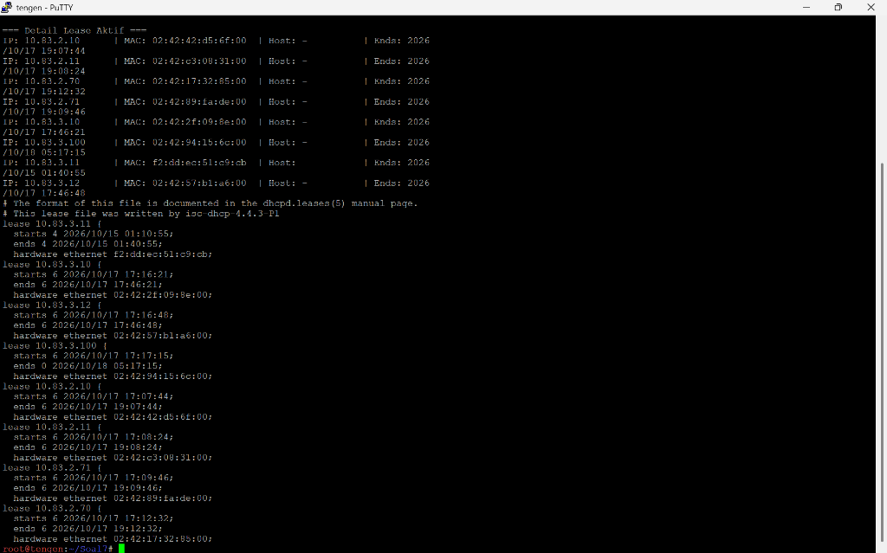

---

## Soal 8

Sebelum Curtain dibuka kembali, buktikan bahwa proses pemberian alamat berjalan sesuai protokol. Lakukan packet capture saat salah satu client Network 2 atau Network 3 meminta lease baru. Gunakan tcpdump pada tengen atau jalur menuju Data Center untuk menunjukkan urutan DHCPDISCOVER -> DHCPOFFER -> DHCPREQUEST -> DHCPACK. Identifikasi alamat server, alamat yang diberikan, lease time, dan field giaddr. Pastikan nilai giaddr sesuai dengan interface jichi yang menerima request dari subnet client.

### Konfigurasi dan Penjelasan:
Kami melakukan penangkapan paket menggunakan Wireshark pada antarmuka jalur menuju tengen (port UDP 67/68) saat klien itadori mengajukan permintaan alamat IP baru.

Empat tahapan jabat tangan DORA tertangkap secara runtut:
1. DHCP Discover: jichi meneruskan siaran klien dengan menyematkan alamat relay giaddr 10.83.2.1.
2. DHCP Offer: tengen menawarkan alamat IP 10.83.2.10 kembali ke alamat relay 10.83.2.1.
3. DHCP Request: klien itadori mengajukan konfirmasi pemilihan alamat yang ditawarkan.
4. DHCP ACK: server tengen meresmikan peminjaman alamat sewa kepada klien.

### Bukti Verifikasi:
Hasil tangkapan paket Wireshark yang memperlihatkan urutan DHCP Discover, Offer, Request, dan ACK:

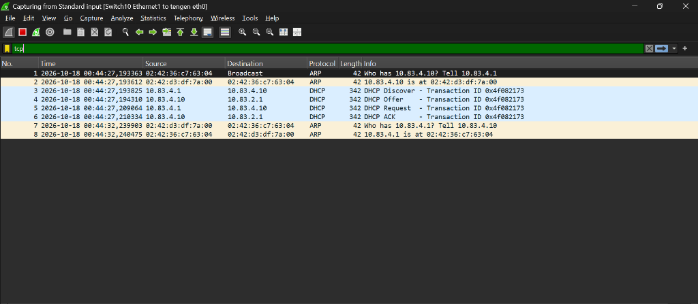

---

## Soal 9

Sebuah gangguan memutus jalur relay dan membuat permintaan alamat tidak sampai ke Data Center. Hentikan service DHCP Relay pada jichi, lalu paksa salah satu client di Network 2 atau Network 3 meminta lease baru dan catat gejalanya. Pulihkan service relay, ulangi permintaan DHCP, lalu buktikan bahwa client kembali memperoleh alamat dari pool yang benar dengan gateway semula.

### Konfigurasi dan Penjelasan:
Untuk menguji toleransi gangguan, kami menghentikan layanan isc-dhcp-relay pada router jichi. Saat itadori mencoba memperbarui alamat IP, klien mengalami batas waktu habis (timeout) karena paket broadcast tidak dapat diteruskan ke Data Center tanpa adanya proses relay.

Setelah layanan relay diaktifkan kembali pada jichi, klien itadori langsung berhasil mendapatkan kembali alamat IP 10.83.2.10 dari Pool 1 dengan gateway default 10.83.2.1.

### Bukti Verifikasi:
Pengujian saat relay dihentikan dan klien mengalami kegagalan sewa:

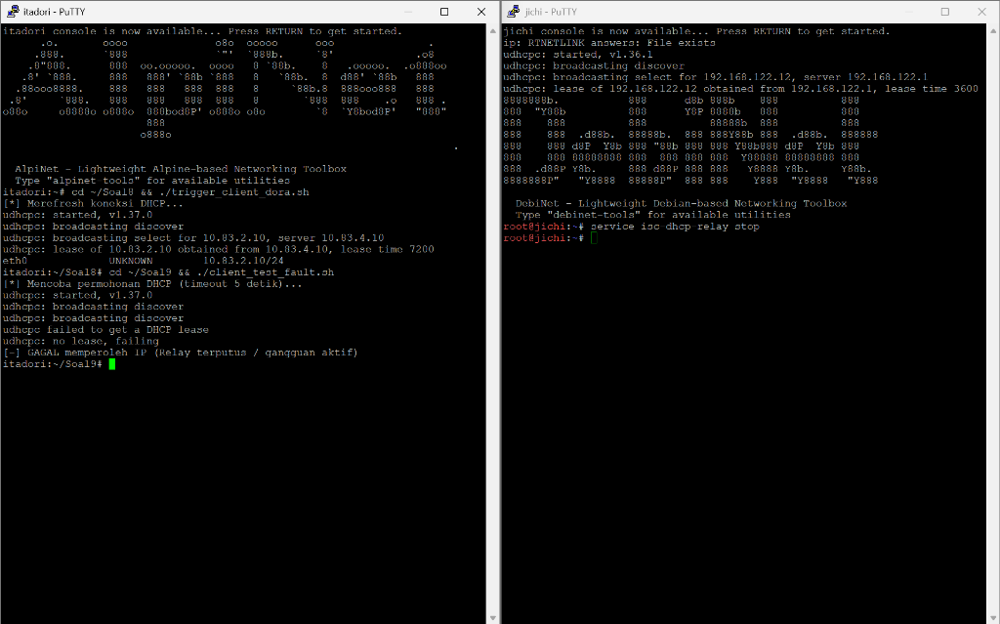

Pengujian saat relay dipulihkan dan klien kembali menerima alamat dengan normal:

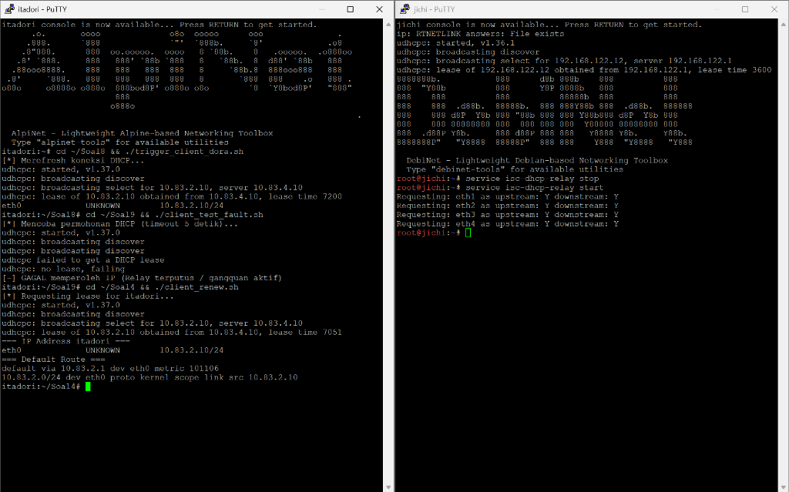

---

## Soal 10

Setelah gangguan Shibuya tertangani, pastikan pemulihan bertahan setelah restart. Aktifkan autostart DHCP Server pada tengen dan DHCP Relay pada jichi, lalu restart kedua node. Verifikasi status layanan, IP, gateway, lease, dan konektivitas client Network 2 sampai 3. Pastikan kebijakan Pool 1, Pool 2, short lease, long lease, dan fixed address tetap berlaku.

### Konfigurasi dan Penjelasan:
Pada lingkungan container debinet GNS3, konfigurasi yang berjalan di memori perlu dipulihkan secara otomatis saat sistem menyala ulang. Kami menyiapkan skrip /root/init.sh pada jichi dan tengen yang otomatis dijalankan saat booting.

Pada jichi, skrip ini mengembalikan konfigurasi seluruh antarmuka eth0 sampai eth4, aturan iptables NAT, forwarding IPv4, serta menjalankan ulang layanan isc-dhcp-relay.

Pada tengen, skrip memulihkan alamat IP statis 10.83.4.10, file konfigurasi /etc/dhcp/dhcpd.conf, dan menjalankan ulang layanan isc-dhcp-server.

### Bukti Verifikasi:
Verifikasi status layanan dan konfigurasi antarmuka pada tengen dan jichi setelah kedua node di-restart:

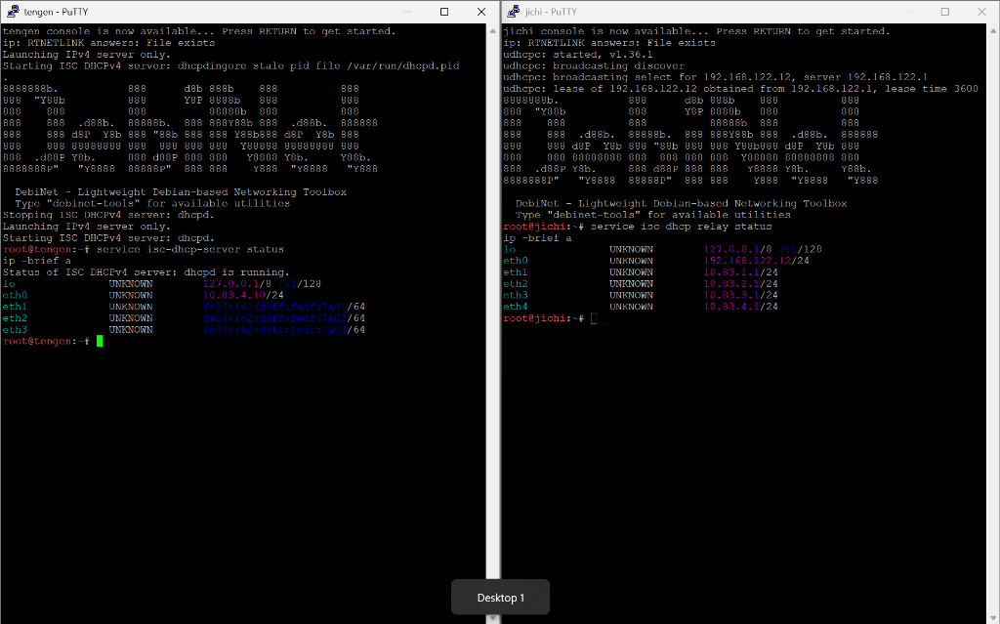

---

## Soal 11

Utahime dan Shoko ditugaskan membangun sistem penamaan domain resmi agar seluruh pos tidak perlu menghafal alamat IP mentah. Konfigurasikan BIND9 pada utahime sebagai DNS Master dan shoko sebagai DNS Slave untuk mengelola domain jujutsu.k39.com. Atur SOA record, NS delegasi untuk kedua server, dan terapkan allow-transfer dari Master ke Slave. Pastikan file zona berhasil tersinkronisasi otomatis ke shoko saat nomor serial di utahime dinaikkan, lalu buktikan dengan melakukan query dig ke kedua server dari salah satu client.

### Konfigurasi dan Penjelasan:
Kami memasang paket bind9, bind9utils, dan dnsutils pada utahime dan shoko. Sebelum instalasi, resolver sementara diarahkan ke 192.168.122.1 agar kedua node dapat mengunduh paket melalui NAT pada jichi.

Pada utahime, zona jujutsu.k39.com dideklarasikan bertipe master dengan file zona di /etc/bind/jujutsu/jujutsu.k39.com. Opsi notify yes, also-notify, dan allow-transfer dibatasi hanya untuk 10.83.1.3 sehingga zone transfer hanya boleh dilakukan oleh shoko. Isi zona memuat record SOA (primary server utahime.jujutsu.k39.com, serial awal 2026101501), dua record NS untuk utahime dan shoko sebagai delegasi, record A untuk utahime (10.83.1.2) dan shoko (10.83.1.3), serta record A pada apex domain yang mengarah ke gojo (10.83.1.4).

Pada shoko, zona yang sama dideklarasikan bertipe slave dengan masters 10.83.1.2 dan file replika di /var/lib/bind/jujutsu.k39.com. Kedua server memakai allow-query any dan dnssec-validation no agar dapat melayani query dari seluruh client. Konfigurasi divalidasi dengan named-checkconf dan named-checkzone sebelum service named di-restart.

Sinkronisasi otomatis bekerja melalui mekanisme NOTIFY. Setiap kali nomor serial SOA di utahime dinaikkan, utahime memberi tahu shoko, lalu shoko membandingkan serial dan menarik zona terbaru melalui zone transfer. Hal ini dibuktikan dengan query SOA ke kedua server dari client itadori, di mana nilai serial pada utahime dan shoko harus sama.

### Bukti Verifikasi:
Konfigurasi dan validasi zona pada DNS Master utahime:

Query SOA dari client itadori ke utahime dan shoko yang menghasilkan nilai serial yang sama:

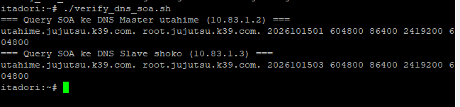

---

## Soal 12

Peta domain harus memetakan pintu masuk utama dan tetap bisa mencari alamat di luar kawasan Shibuya. Pada utahime, buat A record jujutsu.k39.com yang mengarah ke gojo, serta CNAME www yang merujuk ke domain utama tersebut. Buat pula Reverse DNS (zona PTR) untuk melacak IP gojo kembali ke domain resminya, dan aktifkan fitur DNS Forwarder pada BIND9 mengarah ke IP gateway internet (192.168.122.1). Uji dari client dengan dig untuk mengecek CNAME, PTR, dan buktikan client tetap bisa melakukan ping ke domain internet seperti google.com.

### Konfigurasi dan Penjelasan:
Pada utahime, kami menambahkan record A untuk gojo (10.83.1.4), memastikan record A jujutsu.k39.com mengarah ke gojo, serta menambahkan record CNAME www yang mengarah ke jujutsu.k39.com. Serial SOA dinaikkan menjadi 2026101503 agar slave mengenali adanya perubahan zona dan melakukan transfer ulang, dibantu oleh notify dari master.

Untuk resolusi balik, kami membuat zona 1.83.10.in-addr.arpa pada utahime dengan record PTR 4 yang mengarah ke jujutsu.k39.com, karena host terakhir 4 pada subnet 10.83.1.0/24 adalah gojo. Zona ini juga diizinkan untuk ditransfer ke shoko.

Pada shoko, kami menambahkan deklarasi zona reverse bertipe slave dengan master 10.83.1.2 sehingga kedua DNS server menyajikan data yang sama. Pada kedua server, kami menambahkan forwarders 192.168.122.1 pada named.conf.options. Dengan begitu, query untuk domain di luar zona k39.com (misalnya google.com) diteruskan ke resolver gateway internet, sehingga client yang memakai DNS 10.83.1.2 atau 10.83.1.3 tetap dapat mengakses internet menggunakan nama domain.

### Bukti Verifikasi:
Konfigurasi record A, CNAME, PTR, dan forwarder pada utahime beserta hasil named-checkzone:

Pengujian A record, CNAME, PTR, dan ping google.com dari client itadori:

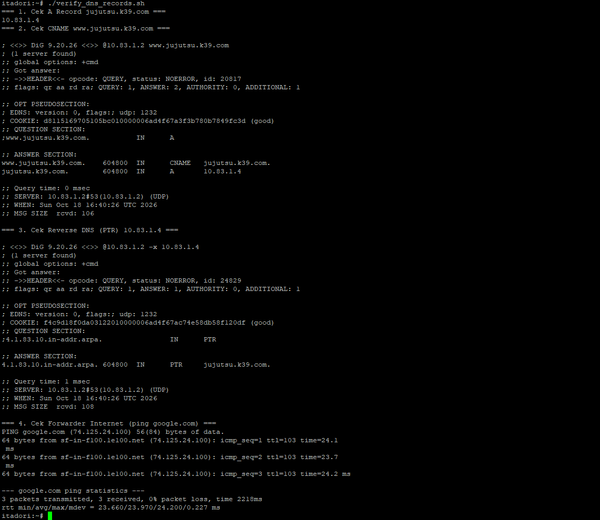

---

## Soal 13

Kepala Sekolah Yaga dan Inumaki mendirikan database terpusat yang redundan agar log aktivitas kutukan tetap aman tersimpan. Konfigurasikan MariaDB pada yaga sebagai DB-Master dan inumaki sebagai DB-Slave. Buat database db_shibuya_k39 beserta tabel request_logs di Master, aktifkan binary logging (log-bin, server-id), lalu hubungkan inumaki sebagai Slave yang menyalin data secara realtime dengan CHANGE MASTER TO. Berikan hak akses remote bagi seluruh node di Network 4, lalu buktikan replikasi berhasil dengan memasukkan data baru di Master dan memeriksa hasilnya di Slave.

### Konfigurasi dan Penjelasan:
Pada yaga, kami memasang mariadb-server dan mengaktifkan binary log (log_bin) dengan server-id 1, bind-address 0.0.0.0, serta binlog_do_db db_shibuya_k39 sehingga hanya perubahan pada database tersebut yang direplikasi. Kami membuat database db_shibuya_k39 dengan tabel request_logs yang berisi kolom id, worker_name, client_ip, dan created_at.

Dua user dibuat pada master. User repl_user dengan hak REPLICATION SLAVE digunakan oleh inumaki untuk menarik binlog. User jujutsu_app dibatasi dari host 10.83.4.% dan diberi hak penuh pada db_shibuya_k39, sehingga seluruh node di Network 4 (termasuk worker API) dapat mengakses database secara remote, sedangkan host dari jaringan lain tidak. Nilai File dan Position dari perintah SHOW MASTER STATUS dicatat sebagai titik awal replikasi.

Pada inumaki, kami menggunakan server-id 2 dengan relay-log, log_bin, dan read_only aktif agar slave hanya menerima data dari master. Skema db_shibuya_k39 dan tabel request_logs dibuat terlebih dahulu karena posisi binlog diambil setelah skema tersebut ada di master. Selanjutnya replikasi diarahkan ke 10.83.4.8 melalui CHANGE MASTER TO dengan File dan Position dari yaga, lalu dijalankan dengan START SLAVE. Status replikasi dianggap sehat bila Slave_IO_Running dan Slave_SQL_Running bernilai Yes tanpa Last_Error.

Untuk membuktikan replikasi berjalan secara realtime, kami memasukkan baris data baru ke tabel request_logs pada yaga, lalu menjalankan SELECT pada inumaki dan memastikan baris yang sama muncul di slave.

### Bukti Verifikasi:

Data baru yang dimasukkan di yaga (Master) dan muncul di inumaki (Slave):

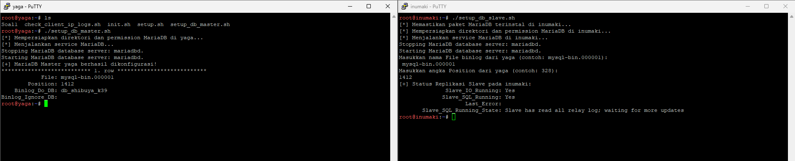

---

## Soal 14

Para penyihir lapangan bersiaga di Data Center sebagai pekerja backend untuk memproses aplikasi. Pasang Nginx dan PHP-FPM pada maki dan panda untuk menyajikan web frontend yang menampilkan hostname masing-masing. Pada nanami, todo, dan kirara, siapkan layanan API yang mencatat log request ke database yaga. Konfigurasikan virtual host agar worker merespons domain layanan yang ditentukan. Batasi akses langsung dari klien ke worker, web worker hanya menerima trafik melalui jalur proxy web yang ditentukan, sedangkan worker API hanya menerima trafik melalui geto. Uji bahwa akses langsung dari klien ditolak, sementara akses melalui reverse proxy tetap berhasil.

### Konfigurasi dan Penjelasan:
Pada maki dan panda, kami memasang nginx dan php-fpm. Halaman index.php pada /var/www/jujutsu menampilkan teks yang memuat hostname worker yang melayani request, sehingga distribusi beban dapat dibuktikan pada soal berikutnya. Virtual host merespons server_name jujutsu.k39.com dan www.jujutsu.k39.com, serta hanya mengizinkan 10.83.1.4 (gojo) melalui aturan allow dan deny all, sehingga web worker hanya dapat dijangkau lewat reverse proxy.

Pada nanami, todo, dan kirara, kami memasang nginx, php-fpm, php-mysql, dan mariadb-client. Skrip index.php pada /var/www/api mengembalikan respons JSON. Skrip ini membuka koneksi ke yaga (10.83.4.8) memakai user jujutsu_app, menyimpan worker_name (hostname) dan client_ip ke tabel request_logs menggunakan prepared statement, lalu mengembalikan status, nama worker, client_ip, dan timestamp. Nilai client_ip diambil dari header X-Real-IP bila tersedia, dan jika tidak ada digunakan REMOTE_ADDR. Virtual host API hanya mengizinkan 10.83.4.2 (geto), sehingga akses harus melalui Internal Load Balancer.

Socket PHP-FPM dideteksi otomatis pada /run/php agar konfigurasi fastcgi_pass tidak bergantung pada versi PHP. Konfigurasi default Nginx dihapus, lalu dilakukan nginx -t sebelum service di-restart.

Pengujian dilakukan dengan dua skenario. Akses langsung dari client ke maki, panda, nanami, todo, atau kirara ditolak dengan 403 Forbidden, sedangkan akses melalui reverse proxy gojo dan load balancer geto tetap berhasil.

### Bukti Verifikasi:

Akses langsung dari client ke worker ditolak dengan 403 Forbidden:

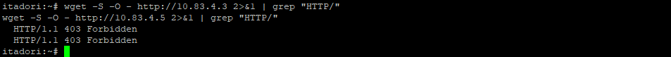

Akses melalui reverse proxy tetap berhasil:

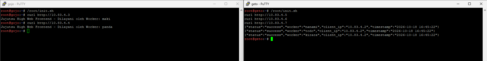

---

## Soal 15

Geto bertugas mengendalikan pembagian beban request API di internal Data Center agar server tidak tumbang bersamaan. Konfigurasikan Nginx pada geto sebagai Load Balancer internal dengan upstream api_cluster yang mengarahkan trafik ke nanami dan todo. Terapkan algoritma Weighted Round Robin dengan bobot 3:1, di mana nanami menerima porsi beban tiga kali lebih banyak daripada todo. Buktikan distribusi beban ini dengan melakukan loop request berulang kali ke geto dari jaringan lokal Data Center dan periksa rasio responnya.

### Konfigurasi dan Penjelasan:
Pada geto, kami memasang nginx dan curl, lalu mendefinisikan upstream api_cluster yang berisi nanami (10.83.4.5) dengan weight=3 dan todo (10.83.4.6) dengan weight=1. Dengan bobot ini, dari setiap empat request, tiga diteruskan ke nanami dan satu ke todo.

Blok server pada port 80 meneruskan seluruh request ke upstream tersebut dengan proxy_pass dan menambahkan header Host, X-Real-IP, serta X-Forwarded-For agar informasi asal request tidak hilang. Konfigurasi default dihapus, lalu service Nginx di-restart setelah nginx -t lolos.

Untuk pengujian, kami menjalankan loop delapan request curl ke 10.83.4.2 dari node di jaringan lokal Data Center. Karena respons API memuat nama worker, jumlah kemunculan nanami dan todo dapat dihitung. Hasil yang diharapkan adalah enam respons dari nanami dan dua dari todo, atau rasio 3:1.

### Bukti Verifikasi:
Konfigurasi upstream WRR dan status Nginx pada geto dan Delapan request ke geto yang memperlihatkan distribusi 3:1 antara nanami dan todo:

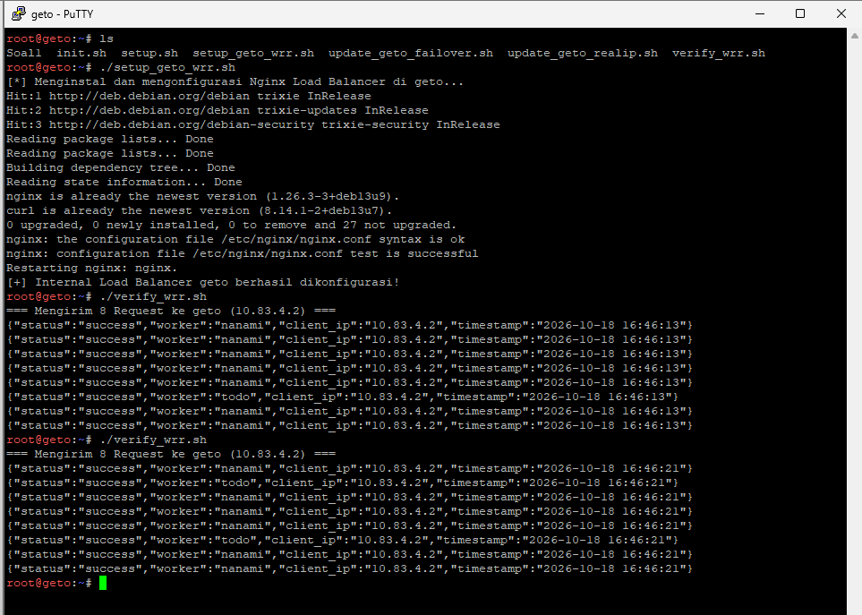

---

## Soal 16

Gojo berdiri di perbatasan DMZ sebagai gerbang publik tunggal bagi seluruh client dari luar maupun dalam. Konfigurasikan Nginx pada gojo untuk melayani domain jujutsu.k39.com dan www.jujutsu.k39.com menggunakan metode Path-Based Routing. Atur agar request root (/) diteruskan secara Round Robin ke worker frontend (maki dan panda), sedangkan request ke path /api diteruskan langsung ke geto. Uji dari client Divisi A atau B bahwa akses ke web utama dibalas oleh Maki/Panda, sedangkan akses ke /api diteruskan dan dijawab oleh Nanami/Todo.

### Konfigurasi dan Penjelasan:
Pada gojo, kami membuat upstream frontend_cluster berisi maki (10.83.4.3) dan panda (10.83.4.4) yang dibagi secara round robin. Server block melayani nama jujutsu.k39.com dan www.jujutsu.k39.com, dengan routing berbasis path sebagai berikut:
1. location / diteruskan ke frontend_cluster.
2. location /api diteruskan ke geto melalui proxy_pass http://10.83.4.2/. Tanda garis miring di akhir alamat membuat Nginx membuang prefix /api sehingga API worker menerima request pada path root, tempat index.php berada.

Pada kedua location, kami menambahkan header Host, X-Real-IP, dan X-Forwarded-For agar alamat client asli dapat diteruskan ke lapisan di belakangnya. Hal ini menjadi dasar untuk Soal 17.

Karena client memperoleh DNS 10.83.1.2 dan 10.83.1.3 dari DHCP (Soal 5), nama jujutsu.k39.com dapat langsung diakses dari client tanpa mengetik alamat IP.

### Bukti Verifikasi:
Konfigurasi reverse proxy dan status Nginx pada gojo:

Akses dari client ke jujutsu.k39.com yang dilayani bergantian oleh maki dan panda:

Akses dari client ke jujutsu.k39.com/api yang dijawab oleh nanami atau todo:

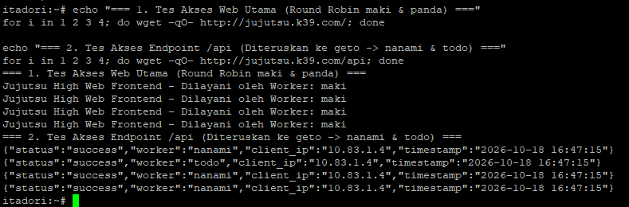

---

## Soal 17

Komando pusat perlu mengetahui IP asli klien yang mengirimkan request tanpa tertukar dengan IP proxy perantara. Konfigurasikan gojo dan geto agar meneruskan informasi alamat klien melalui header X-Real-IP dan X-Forwarded-For. Pastikan geto hanya mempercayai informasi alamat klien yang diterima dari proxy terpercaya, dan skrip API menyimpan alamat klien yang telah diverifikasi ke kolom client_ip pada tabel request_logs di database yaga. Uji dengan mengirimkan request dari klien Network 2 dan Network 3 ke endpoint /api, kemudian periksa database untuk memastikan alamat yang tercatat sesuai dengan IP klien asal, bukan IP gojo atau geto.

### Konfigurasi dan Penjelasan:
Gojo meneruskan alamat client ke geto melalui header X-Real-IP dan X-Forwarded-For (proxy_add_x_forwarded_for), sedangkan geto meneruskannya lagi ke worker API. Pada geto, kami menambahkan tiga direktif real-IP pada server block:
1. set_real_ip_from 10.83.1.4, yaitu hanya gojo yang dipercaya sebagai proxy.
2. real_ip_header X-Forwarded-For, yaitu alamat client dibaca dari header tersebut.
3. real_ip_recursive on, yaitu Nginx menelusuri daftar alamat dari kanan ke kiri dan melewati alamat proxy terpercaya hingga menemukan alamat pertama yang tidak dipercaya.

Dengan konfigurasi ini, variabel remote_addr pada geto bernilai alamat client asli, bukan 10.83.1.4. Nilai tersebut kemudian diteruskan ke worker melalui header X-Real-IP, lalu dibaca skrip PHP dan disimpan ke kolom client_ip pada tabel request_logs. Karena hanya gojo yang dipercaya, header X-Forwarded-For yang dipalsukan oleh pihak lain tidak akan diterima begitu saja oleh geto.

Verifikasi dilakukan dengan mengirim request ke jujutsu.k39.com/api dari client Network 2 dan client Network 3, lalu memeriksa 10 baris terakhir tabel request_logs pada yaga. Kolom client_ip harus berisi alamat client asal (10.83.2.x dan 10.83.3.x), bukan 10.83.1.4 (gojo) maupun 10.83.4.2 (geto).

### Bukti Verifikasi:

Isi tabel request_logs pada yaga yang mencatat alamat client sebenarnya:

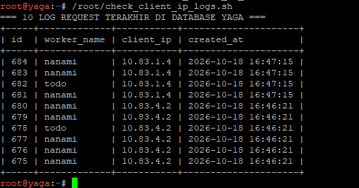

---

## Soal 18

nanami dan todo merupakan worker API utama, sedangkan kirara disiapkan sebagai worker cadangan. Konfigurasikan upstream api_cluster pada geto agar kirara menjadi server backup, serta terapkan passive health check dengan parameter max_fails=2 dan fail_timeout=5s pada worker API utama. Pastikan kirara menjalankan layanan API yang kompatibel dengan endpoint utama. Simulasikan gangguan dengan menghentikan layanan Nginx atau layanan API pada nanami dan todo. Buktikan dari klien bahwa request ke /api dialihkan ke kirara dan menghasilkan respons API yang valid tanpa error 502 Bad Gateway.

### Konfigurasi dan Penjelasan:
Pada upstream api_cluster di geto, nanami dan todo diberi parameter max_fails=2 dan fail_timeout=5s. Artinya, bila terjadi dua kegagalan berturut-turut dalam jendela 5 detik, worker dianggap tidak tersedia selama 5 detik sebelum dicoba kembali. Kirara ditambahkan dengan parameter backup sehingga hanya menerima trafik ketika seluruh server utama tidak tersedia. Bobot 3:1 dan konfigurasi real-IP dari Soal 17 tetap dipertahankan.

Kirara dipasang dengan skrip API yang sama seperti nanami dan todo (Nginx, PHP-FPM, php-mysql, index.php yang mencatat ke database yaga, dan hanya menerima akses dari geto), sehingga format respons JSON-nya kompatibel dengan endpoint utama.

Pengujian dilakukan secara bertahap:
1. Saat semua worker aktif, request hanya dilayani oleh nanami dan todo sesuai bobot.
2. Saat service Nginx pada nanami dan todo dimatikan, request dari client ke /api tetap berhasil dan seluruhnya dilayani oleh kirara dengan respons API yang valid, tanpa error 502 Bad Gateway, karena geto langsung mengalihkan request ke server backup.
3. Saat kedua worker utama dinyalakan kembali, trafik kembali ke nanami dan todo, sedangkan kirara kembali menjadi cadangan.

### Bukti Verifikasi:

Request ke /api dari client dijawab oleh kirara tanpa error 502:

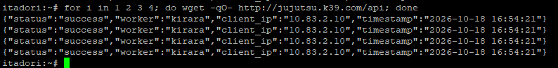

---

## Soal 19

gojo bertugas mengoptimalkan layanan web sekaligus membatasi request berlebihan. Konfigurasikan Nginx Proxy Caching untuk halaman web frontend dengan masa berlaku cache 10 menit dan tambahkan header X-Cache-Status. Terapkan rate limiting pada path /api dengan batas 10 request per detik per IP klien. Buktikan bahwa request ke halaman web yang memenuhi syarat cache menghasilkan status MISS pada akses awal dan HIT pada akses berikutnya. Uji rate limiting secara terpisah dengan mengirimkan request beruntun ke /api, kemudian catat status respons yang dihasilkan ketika batas terlampaui.

### Konfigurasi dan Penjelasan:
Untuk caching, kami membuat direktori /var/cache/nginx/frontend_cache milik www-data, lalu mendefinisikan proxy_cache_path dengan zona kunci WEB_CACHE (10 MB, maksimal 100 MB, inactive 10 menit). Pada location /, kami mengaktifkan proxy_cache WEB_CACHE dengan proxy_cache_valid 200 10m, sehingga respons berstatus 200 disimpan selama 10 menit. Direktif proxy_ignore_headers dipakai agar header Cache-Control, Expires, dan Set-Cookie dari backend tidak membatalkan cache. Header X-Cache-Status ditambahkan pada respons agar status MISS atau HIT dapat dilihat dari client. Cache hanya dipasang pada frontend, sedangkan /api sengaja tidak di-cache karena setiap request harus dicatat ke database.

Untuk rate limiting, kami mendefinisikan limit_req_zone API_LIMIT berbasis binary_remote_addr dengan rate=10r/s, sehingga batas diterapkan per alamat IP client. Zona ini diterapkan pada location /api dengan limit_req_status 429, dan tidak memakai burst sehingga request di atas laju 10 per detik langsung ditolak dengan kode 429 Too Many Requests.

Pada pengujian cache, request pertama ke jujutsu.k39.com menunjukkan X-Cache-Status MISS, sedangkan request berikutnya menunjukkan HIT dan dilayani dari cache gojo tanpa menghubungi maki atau panda. Pada pengujian rate limiting yang dilakukan terpisah, request beruntun ke /api memperlihatkan sebagian respons berubah menjadi 429 ketika batas terlampaui.

### Bukti Verifikasi:

Header X-Cache-Status yang berubah dari MISS menjadi HIT pada request berikutnya: dan Request beruntun ke endpoint /api yang mulai ditolak dengan status 429:

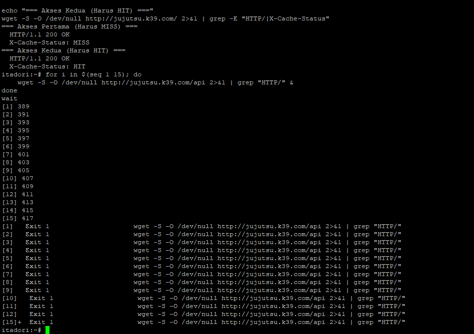

---

## Soal 20

Sebelum Curtain di Shibuya resmi dibuka, Kusakabe memimpin audit untuk menguji kapasitas layanan. Dari terminal kusakabe, jalankan benchmark menggunakan Apache Benchmark dengan parameter -n 600 -c 30 menuju http://jujutsu.k39.com/. Catat Requests per Second (RPS), latensi, dan jumlah request yang gagal. Lakukan pengujian tambahan pada endpoint /api untuk mengamati efek rate limiting. Bandingkan hasil pengujian baseline dengan hasil ketika rate limiting aktif, serta gunakan access log gojo untuk membedakan kegagalan aplikasi, koneksi, dan request yang ditolak oleh kebijakan rate limit.

### Konfigurasi dan Penjelasan:
Dari kusakabe, kami memasang apache2-utils dan curl, lalu menjalankan ab dengan 600 request dan konkurensi 30 (ab -n 600 -c 30) terhadap dua target secara terpisah, yaitu http://jujutsu.k39.com/ sebagai baseline web frontend dan http://jujutsu.k39.com/api sebagai pengujian efek rate limiting. Pengujian /api dilakukan dua kali, yaitu saat rate limiting belum diaktifkan sebagai baseline dan saat rate limiting aktif.

Hasil dari ketiga pengujian dirangkum pada tabel berikut:

| Pengujian | Requests per Second | Time per Request (mean) | Failed Requests | Non-2xx Responses |
| :--- | :--- | :--- | :--- | :--- |
| Baseline web frontend (/) | ... | ... ms | ... | ... |
| Baseline /api (tanpa rate limiting) | ... | ... ms | ... | ... |
| /api (rate limiting aktif) | ... | ... ms | ... | ... |

Pada gojo, kami menganalisis access.log dan error.log untuk membedakan tiga jenis kegagalan:
1. Request ditolak kebijakan rate limit: berstatus 429 pada access.log dan memiliki entri "limiting requests" pada error.log. Request ini sengaja ditolak oleh gojo dan tidak pernah sampai ke geto.
2. Kegagalan aplikasi atau upstream: berstatus 5xx (misalnya 502 atau 504) pada access.log, menandakan gojo gagal memperoleh jawaban dari geto atau worker.
3. Kegagalan koneksi: tidak tercatat di access.log karena request tidak pernah sampai ke Nginx, dan muncul pada keluaran ab sebagai Failed requests kategori Connect atau Receive.

Interpretasi hasil:
1. Frontend: hampir seluruh request berstatus 200 karena setelah request pertama, konten dilayani dari proxy cache gojo sehingga beban pada maki dan panda sangat kecil.
2. API tanpa rate limiting: seluruh request diteruskan ke geto dan dilayani nanami atau todo, sehingga throughput dibatasi oleh kemampuan worker dan database.
3. API dengan rate limiting: request dikirim dengan konkurensi 30 tanpa burst, sehingga request yang melebihi 10 r/s ditolak dengan 429. Hal ini tampak pada baris Non-2xx responses di keluaran ab, hitungan status 429 pada access.log, dan entri "limiting requests" pada error.log. Request yang lolos tetap dilayani nanami atau todo sesuai bobot 3:1 dan dicatat ke database.

Hasil ini menunjukkan bahwa cache dan rate limiting berfungsi sesuai tujuan, yaitu mempercepat konten frontend serta melindungi lapisan API dan database dari lonjakan trafik.

### Bukti Verifikasi:
Hasil Apache Benchmark ke web frontend dari kusakabe:

Ringkasan status code pada access.log dan bukti penolakan rate limit pada error.log gojo:

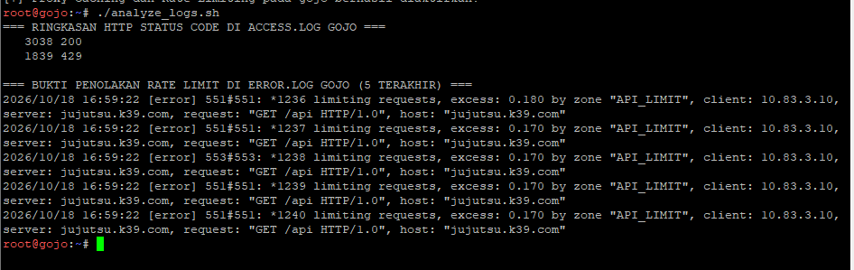
